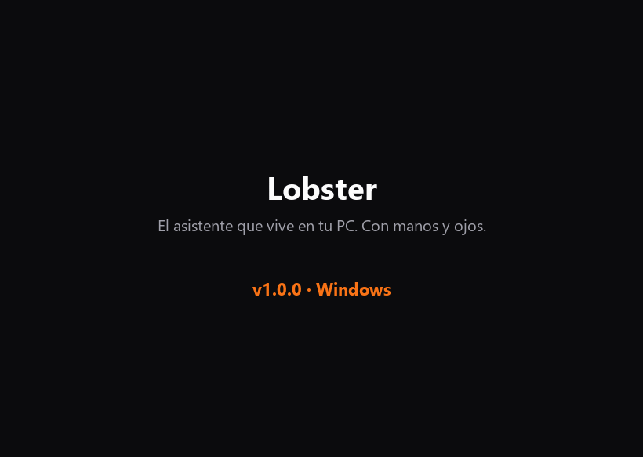

# 🦞 Lobster Assistant



Asistente de IA que corre en **tu** computadora: chat, agente con herramientas, visión de pantalla y bot de Telegram. Sin suscripciones y sin que el proyecto pague tokens: usás una nube gratuita o un modelo local que corre en tu propia máquina.

> Estado: **v1.0.0** — funciona en Windows. Probado en una AMD E-350 (2 núcleos, 3,5 GB RAM).

---

## Qué hace

- **Chat** con streaming, historial por sesión y memoria entre mensajes.
- **Agente con 23 herramientas**: leer/escribir archivos, ejecutar comandos de una allowlist, buscar en la web, abrir URLs, capturas de pantalla, portapapeles, notas y control del navegador por DOM (Playwright).
- **Visión**: describe lo que hay en la pantalla.
- **Dos cerebros intercambiables** desde el propio chat:
  - **Nube gratuita** (Gemini / Groq / Cerebras / OpenRouter): rápido, necesita internet y una clave gratis.
  - **Local** (motor propio `llama-server`, llama.cpp): sin internet, nada sale de tu PC, más lento.
- **Bot de Telegram** opcional, con la misma personalidad y herramientas.
- **Permisos por riesgo**: cada herramienta se clasifica en `low / medium / high / critical` y se resuelve como permitir, confirmar o bloquear. Incluye anti-secretos y anti-destructivos.

---

## Requisitos

| | |
|---|---|
| Sistema | Windows 10/11 (64 bits) |
| Node.js | 20 o superior (LTS) |
| RAM | 4 GB recomendado (funciona con 3,5 GB; el modo local pide ~1 GB) |
| Disco | ~1,5 GB con un modelo local |

---

## Instalación

Hay dos formas. La **portable** no necesita instalar nada (recomendada).

### Opción A — Portable (sin Node instalado)

1. Bajá **`lobster-portable-v1.0.0.zip`** (62 MB) desde [Releases](https://github.com/jacxas/lobster_assistant_web/releases/latest).
2. Descomprimí la carpeta completa (no lo ejecutes desde adentro del ZIP).
3. Doble clic en **`Lobster.exe`**.

La primera vez pide una clave gratis (opcional); después abre el panel en <http://localhost:3000>. Trae su propio runtime Node, la API compilada y el motor local.

### Opción B — Código fuente (requiere Node.js 20+)

1. Descomprimí el ZIP en una carpeta (por ejemplo `C:\Lobster`).
2. Doble clic en **`instalar.bat`**. Verifica Node, instala dependencias y compila.
3. Para que la IA responda rápido, creá una clave **gratis** en [aistudio.google.com](https://aistudio.google.com) y ejecutá en una consola:

   ```bat
   setx LLM_API_KEY "tu-clave"
   ```

   (Cerrá y volvé a abrir la consola para que tome efecto.)

4. Doble clic en **`arrancar-lobster.bat`** → se abre el panel en <http://localhost:3000>.

**Sin clave** también funciona: cae al motor local, más lento.

### Modo local (opcional)

1. Doble clic en **`instalar-motor.bat`** (baja `llama-server.exe`).
2. En el panel: **Models → descargar** un modelo.
3. En el chat, chip del cerebro → elegir el modelo local.

En una CPU vieja el modo local tarda **1-3 minutos por respuesta**. Es el precio de que nada salga de tu PC.

---

## Uso diario

| Archivo | Para qué |
|---|---|
| `Lobster.exe` (portable) | **Uso normal en la versión portable**: panel + API + motor, sin instalar nada |
| `arrancar-lobster.bat` | Uso normal desde código fuente: panel + API en un solo proceso (`:3000`) |
| `arrancar-desarrollo.bat` | Desarrollo: API con recarga (`:3000`) + panel Vite (`:5173`) |
| `arrancar-produccion.bat` | Igual que el primero, recompilando si hace falta |
| `instalar-motor.bat` | Instala el motor local (llama.cpp) |

Los datos quedan en `apps\.data\` (base SQLite `lobster.db`, modelos `.gguf`). **No se suben a ningún lado.**

### Bot de Telegram

1. Creá un bot con [@BotFather](https://t.me/BotFather) y copiá el token.
2. Pegalo en `apps\bot\.env` como `TELEGRAM_TOKEN=...`.
3. `arrancar-lobster.bat` lo levanta solo.

Comandos: `/cangrejo` activa un modo de habla crustáceo, `/normal` lo apaga.

---

## Configuración

Todo por variables de entorno (o en `.env`, copiando `.env.example`):

| Variable | Para qué |
|---|---|
| `LLM_BASE_URL` / `LLM_API_KEY` / `LLM_MODEL` | Proveedor de nube (protocolo OpenAI) |
| `LLM_VISION_MODEL` | Modelo para mirar imágenes |
| `AGENT_MAX_STEPS` | Pasos máximos del agente (por defecto 8) |
| `AGENT_ALLOW_CLICKS` | `1` habilita clics físicos del mouse (por defecto solo vista previa) |
| `AGENT_BLOCKED_TOOLS` / `AGENT_TRUSTED_TOOLS` | Veto o confianza por herramienta |
| `AGENT_STRICT_LOCAL` | `1` = sin red ni navegador |
| `LOCAL_MAX_TOKENS` | Tope de salida del motor local (por defecto 48) |
| `PORT` | Puerto del API (por defecto 3000) |

---

## Estructura

```
apps/
  server/   API Express + SQLite (agente, herramientas, permisos, cerebros)
  web/      Panel React + Vite
  bot/      Bot de Telegram/Discord/Slack
  engine/   llama-server.exe (motor local, llama.cpp)
packages/
  shared/   Tipos y prompt del sistema
landing/    Sitio público (estático)
scripts/    Utilidades (empaquetado, medición de latencia)
```

---

## Problemas comunes

**"fetch failed" en el chat** → el proveedor de nube no responde o la clave no está cargada. Revisá `LLM_API_KEY` y reiniciá.

**El modo local tarda muchísimo** → normal en CPUs viejas: ~0,2 tokens/s. Usá respuestas cortas o volvé a la nube.

**"Puerto 3000 en uso"** → ya hay otra instancia corriendo. Cerrá la ventana "Lobster" minimizada o cambiá `PORT`.

**no arranca / falta compilar** → ejecutá `instalar.bat` otra vez.

---

## Límites conocidos (v1)

- Solo Windows; el instalador es `.bat`.
- El modo local es usable para frases cortas, no para conversaciones largas en hardware antiguo.
- Requiere Node.js instalado (todavía no hay instalador autocontenido).
- El agente no ejecuta acciones destructivas: pide confirmación o las bloquea según el motor de permisos.

---

## Autor

JACXAS — proyecto Lobster. Licencia MIT (ver `LICENSE` si está incluida en la distribución).
